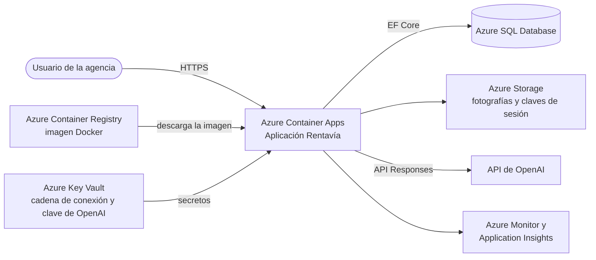
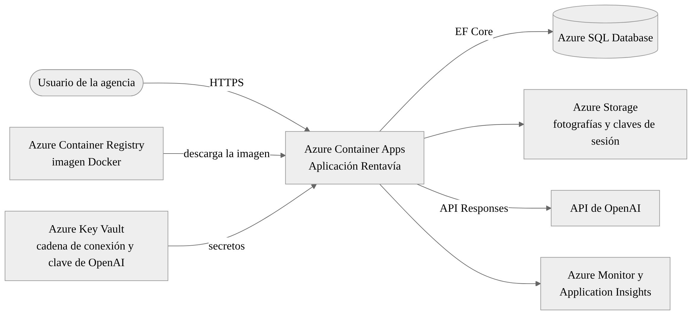

# Propuesta de despliegue en Microsoft Azure

## Servicios seleccionados

| Servicio | Uso en Rentavía |
| --- | --- |
| Azure Container Apps (plan Consumption) | Ejecuta la misma imagen Docker de la web, con HTTPS y escalado automático, incluso a cero cuando no hay uso |
| Azure Container Registry (Basic) | Guarda las versiones de la imagen |
| Azure SQL Database | Base de datos administrada, compatible con el proveedor SQL Server de EF Core |
| Azure Storage | Fotografías de vehículos y claves de sesión, en lugar de los volúmenes locales |
| Azure Key Vault | Cadena de conexión y clave de OpenAI como secretos |
| Azure Monitor / Application Insights | Registros y alertas de errores y de costo |

## Arquitectura





El despliegue seguiría estos pasos:

1. Construir la imagen con el mismo `docker/Dockerfile` y subirla al registro.
2. Crear la base en Azure SQL y aplicar las migraciones con un trabajo de Container Apps que ejecute `--migrate`, igual que el servicio `setup` de Compose.
3. Crear la Container App con la cadena de conexión y `OPENAI_API_KEY` como secretos, y con `Seguridad__RedirigirHttps` activado.
4. Montar Azure Storage en `/app/wwwroot/uploads` y `/app/keys`.

## Beneficios

- Se reutiliza la imagen que ya funciona en Docker, sin cambios en el código.
- Azure SQL Database no requiere instalar ni mantener SQL Server, e incluye copias de seguridad automáticas.
- Container Apps escala según la demanda; una agencia pequeña con poco tráfico paga muy poco por cómputo.
- Cada versión de la imagen queda registrada, lo que permite volver a una anterior.

## Costos aproximados

Escenario estimado en la región East US, en dólares y por mes: una réplica de 0.5 vCPU y 1 GiB activa una hora al día, menos de 50,000 solicitudes, una base pequeña y pocos archivos. No incluye impuestos ni créditos de estudiante.

| Componente | USD por mes | Base del cálculo |
| --- | --- | --- |
| Container Apps | 0.00 | 54,000 vCPU-segundos y 108,000 GiB-segundos al mes, dentro de la asignación gratuita mensual de 180,000 vCPU-segundos, 360,000 GiB-segundos y 2 millones de solicitudes |
| Azure SQL Database (Basic, 5 DTU) | 5.00 a 15.00 | Rango estimado para un nivel básico; el precio exacto se confirma en la calculadora |
| Container Registry Basic | 5.00 | 0.1666 USD por día × 30, según la API pública de precios de Azure |
| Storage, registros y tráfico | 3.00 a 10.00 | Depende del volumen y la retención |
| Total estimado | 13.00 a 30.00 | |

La asignación gratuita de Container Apps se comparte entre todos los recursos de la suscripción. Antes de un despliegue real habría que confirmar los valores en la [calculadora de precios de Azure](https://azure.microsoft.com/en-us/pricing/calculator/).

Fuentes: [facturación de Container Apps](https://learn.microsoft.com/en-us/azure/container-apps/billing), [precios de Azure SQL Database](https://azure.microsoft.com/en-us/pricing/details/azure-sql-database/single/), [API de precios de Azure](https://prices.azure.com/api/retail/prices). Consultadas el 12 de octubre de 2026.

## Costo de OpenAI

El consumo de OpenAI se paga aparte, se use Azure o no. El modelo `gpt-4.1-mini` cuesta USD 0.40 por millón de tokens de entrada y USD 1.60 por millón de salida ([precio oficial](https://developers.openai.com/api/docs/models/gpt-4.1-mini)).

Como ejemplo, cien consultas de unos 2,000 tokens de entrada y 300 de salida costarían alrededor de USD 0.13:

```text
200,000 / 1,000,000 × 0.40 + 30,000 / 1,000,000 × 1.60 = 0.08 + 0.048 = 0.128
```

La aplicación limita a diez consultas por minuto por usuario, envía como máximo veinte candidatos y limita la respuesta a 800 tokens. Aun así, conviene configurar un límite de gasto en la cuenta de OpenAI.
