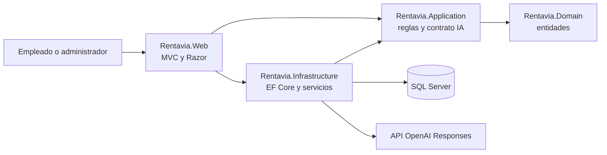

# Manual técnico de Rentavía

## 1. Arquitectura

Rentavía es un monolito modular: una sola aplicación web dividida en cuatro proyectos .NET con responsabilidades separadas. Se eligió así porque una agencia pequeña no necesita microservicios, y un solo despliegue simplifica las transacciones entre reservas, alquileres y pagos.



| Proyecto | Contenido | Depende de |
| --- | --- | --- |
| Rentavia.Domain | Entidades y estados del negocio | Ninguno |
| Rentavia.Application | Cálculo de días y totales, cruce de intervalos, control de versión y la interfaz `IRecomendador` | Domain |
| Rentavia.Infrastructure | `RentaviaDbContext`, migraciones, auditoría, `AgendaService`, `AlquilerService` y `OpenAiRecomendador` | Application |
| Rentavia.Web | Controladores, modelos de formulario, vistas, autenticación y configuración | Application e Infrastructure |

Los CRUD de catálogos usan el contexto de EF Core directamente desde su controlador. Las operaciones que modifican varias tablas a la vez (reservar, entregar, devolver, pagar, programar mantenimiento) están en servicios. No se usan repositorios genéricos, CQRS ni mediadores, para que el flujo se pueda seguir leyendo el código: el controlador recibe el formulario, el servicio aplica las reglas, el contexto guarda y la vista muestra el resultado.

## 2. Tecnologías

| Tecnología | Versión | Uso |
| --- | --- | --- |
| .NET SDK | 10.0.400 (fijado en `global.json`) | Compilación y ejecución |
| ASP.NET Core MVC | 10 | Frontend Razor y backend |
| Entity Framework Core SQL Server | 10.0.11 | Acceso a datos y migraciones |
| ASP.NET Core Identity | 10.0.11 | Cuentas, contraseñas y roles |
| SQL Server | Express o LocalDB en local; 2025 Developer en Docker | Base de datos |
| OpenAI Responses API | `gpt-4.1-mini` configurable | Recomendador |
| Hoja de estilos propia (`site.css`) | Inspirada en Material Design 3, esquema oscuro | Interfaz sin frameworks CSS externos |
| Roboto Flex y Material Symbols | Servidas desde `wwwroot/fonts` | Tipografía e íconos, sin depender de internet |
| jQuery Validation | Servido desde `wwwroot/lib` | Validación en el cliente |
| Docker y Compose | Docker Desktop con motor Linux | Contenerización |

## 3. Estructura del código

| Carpeta | Contenido |
| --- | --- |
| `src/Rentavia.Domain/Entities` | Categoria, Sucursal, Cliente, Vehiculo, Reserva, Ocupacion, Alquiler, Pago, Mantenimiento, Auditoria, Recomendacion |
| `src/Rentavia.Application/Services` | `ReglasAlquiler` y `ReglaNegocioException` |
| `src/Rentavia.Application/Recommendations` | DTO del recomendador e interfaz `IRecomendador` |
| `src/Rentavia.Infrastructure/Data` | Contexto, configuración del modelo, migraciones, auditoría y datos iniciales |
| `src/Rentavia.Infrastructure/Services` | `AgendaService`, `AlquilerService`, `OpenAiRecomendador` |
| `src/Rentavia.Web/Controllers` | Un controlador por módulo; `ProyectoController` es la base con autorización |
| `src/Rentavia.Web/Models` | Formularios con validaciones y modelos de las vistas |
| `src/Rentavia.Web/Views` | Vistas Razor por módulo y el layout común |
| `database/scripts` | SQL generado de las migraciones y script de verificación |
| `docker` | `Dockerfile` y `docker-compose.yml` |
| `scripts` | Arranque local y en Docker, creación de cuentas y `.env` |
| `tests` | Pruebas en C#, recorrido HTTP en Python y capturas con Playwright |

Las clases principales tienen comentarios `///` que explican su responsabilidad.

## 4. Base de datos

El [modelo de datos](../tecnico/Modelo-completo.md) contiene el diagrama entidad-relación y el diccionario. La base tiene once tablas de negocio, siete de Identity y el historial de migraciones.

Hay tres migraciones:

| Migración | Cambio |
| --- | --- |
| `BaseInicialSqlServer` | Identity, categorías, sucursales, clientes y vehículos |
| `OperacionDeRentas` | Reservas, ocupaciones, alquileres, pagos, mantenimientos, auditoría y recomendaciones |
| `ReferenciaAuditoria` | Columna `RegistroClave` para auditar operaciones sobre usuarios |

Decisiones de tipos: el dinero usa `decimal(12,2)`, las fechas con hora usan `datetimeoffset` en UTC y el vencimiento de licencia usa `date`. La interfaz convierte a UTC-6 al mostrar y al recibir fechas.

Restricciones principales: placa única, documento único por tipo, claves foráneas con borrado restringido, `CHECK` en capacidades, kilometraje, combustible, fechas e importes, y un índice filtrado que permite un solo alquiler abierto por vehículo.

## 5. Disponibilidad y concurrencia

La tabla `Ocupaciones` es la agenda única. Cada reserva y cada mantenimiento crean una fila con su intervalo `[inicio, fin)`. Dos intervalos se cruzan si `inicioA < finB && inicioB < finA`, por eso un período que termina a las 10:00 no choca con otro que empieza a las 10:00. Al entregar, el alquiler reutiliza la ocupación de su reserva. Cancelar, devolver o finalizar un mantenimiento la desactiva.

Para evitar que dos empleados reserven el mismo vehículo al mismo tiempo, cada operación de agenda:

1. Abre una transacción serializable.
2. Lee el vehículo con `WITH (UPDLOCK, HOLDLOCK)`. Cualquier otra transacción que intente bloquear ese vehículo espera.
3. Consulta si hay ocupaciones que se crucen.
4. Guarda la reserva, la ocupación y la auditoría, y confirma.

La prueba automatizada "dos conexiones simultáneas" comprueba que solo una de dos reservas concurrentes se confirma.

Las ediciones de cliente, vehículo, reserva y alquiler usan `rowversion`. Si el registro cambió desde que se abrió el formulario, el sistema avisa en lugar de sobrescribir.

La reserva guarda tarifa diaria, días y total estimado. Cambiar la tarifa del vehículo después no altera reservas ni alquileres existentes.

## 6. Seguridad

- Identity guarda las contraseñas con hash. No hay registro público; las cuentas las crea un administrador o el comando `--create-admin`.
- Cookie de sesión HttpOnly y SameSite=Lax, con expiración de 8 horas.
- Bloqueo de 10 minutos tras cinco intentos fallidos. El inicio de sesión admite 20 intentos por minuto por IP y el recomendador 10 consultas por minuto por usuario.
- Todos los módulos exigen rol Administrador o Empleado. Usuarios, reportes, auditoría, la edición de categorías y sucursales y las eliminaciones exigen Administrador.
- Todas las peticiones POST validan el token antifalsificación (`AutoValidateAntiforgeryToken`).
- Los formularios usan modelos propios con validaciones, nunca entidades completas.
- Al bloquear una cuenta se cambia su security stamp; la sesión abierta se invalida en el siguiente chequeo, que ocurre cada minuto.
- Las fotografías se validan por sus primeros bytes (PNG o JPEG), con máximo 2 MB, y se guardan con nombre aleatorio.

## 7. Manejo de errores y auditoría

Las reglas de negocio lanzan `ReglaNegocioException`. `ProyectoController.ErrorFormulario` traduce esa excepción, los conflictos de concurrencia y los errores de base de datos en mensajes que se muestran sobre el formulario. Los errores no controlados llegan a `/Home/Error`, que muestra un código de referencia sin detalles internos.

La auditoría se registra con `db.Registrar(...)` (en `AuditoriaExtensions`) dentro del mismo `SaveChanges` o transacción que la operación, así el evento y el cambio se guardan juntos o no se guarda ninguno. Para los catálogos, `GuardarConAuditoriaAsync` guarda el registro y su auditoría en una transacción. La bitácora no almacena contraseñas, claves ni documentos.

## 8. Integración de IA

### Flujo

1. El usuario indica fechas, pasajeros, maletas, presupuesto diario y preferencias en texto libre.
2. `RecomendacionesController` usa `AgendaService.Disponibles` para obtener los vehículos libres que cumplen capacidad y presupuesto, ordenados por tarifa, hasta un máximo de veinte.
3. `OpenAiRecomendador` envía a `POST https://api.openai.com/v1/responses` las preferencias y los candidatos (id, nombre, capacidades, transmisión y tarifa). No envía datos de clientes.
4. La petición pide salida JSON con esquema estricto: una lista de una a tres sugerencias con `vehiculoId` y `motivo`. Usa `store=false` y `max_output_tokens=800`.
5. El servidor valida la respuesta: entre una y tres sugerencias, sin IDs repetidos, todos dentro de la lista de candidatos y con motivo no vacío de hasta 500 caracteres.
6. La vista muestra cada vehículo con su explicación y un botón para reservarlo por el flujo normal.
7. Se guarda en `Recomendaciones` la entrada, los candidatos, el resultado, el origen, el modelo y la versión del prompt (`rentavia-v1`).

Las instrucciones del modelo le indican que tome las preferencias como datos y no como órdenes, que no invente IDs ni precios y que no reserve ni evalúe personas.

### Respaldo

Si no hay clave, la API responde con error, la respuesta llega incompleta o no pasa la validación, o se superan los 30 segundos de espera, el sistema devuelve los tres candidatos más económicos con origen **Reglas (sin IA)**. La pantalla siempre muestra el origen.

### Configuración

| Clave | Fuente |
| --- | --- |
| `OPENAI_API_KEY` u `OpenAI__ApiKey` | Variable de entorno del servidor |
| `OpenAI__Modelo` | Variable de entorno; por defecto `gpt-4.1-mini` |

En Docker, Compose las toma de `.env` (`OPENAI_API_KEY` y `OPENAI_MODEL`).

### Beneficio

El empleado obtiene en segundos dos o tres opciones justificadas que consideran necesidades difíciles de filtrar con campos fijos (tipo de viaje, comodidad, tipo de equipaje). Como la IA solo elige entre vehículos ya verificados como libres, nunca sugiere algo que no se pueda reservar.

Referencias: [API Responses](https://developers.openai.com/api/reference/resources/responses/methods/create), [salidas estructuradas](https://developers.openai.com/api/docs/guides/structured-outputs?api-mode=responses), [modelo gpt-4.1-mini](https://developers.openai.com/api/docs/models/gpt-4.1-mini).

## 9. Configuración

| Archivo o variable | Propósito |
| --- | --- |
| `appsettings.json` | Registro de logs y hosts permitidos |
| `appsettings.Development.json` | Conexión a `.\SQLEXPRESS` con autenticación de Windows |
| `ConnectionStrings__Rentavia` | Cadena de conexión en Docker (la arma Compose) |
| `Seguridad__RedirigirHttps` | `false` en Docker local; en otros ambientes fuera de Development se activan HSTS y redirección HTTPS |
| `DataProtection__Ruta` | Carpeta donde persisten las claves de cookies (`/app/keys` en Docker) |
| `.env` | Secretos para Docker y el lanzador; no se comparte |

La aplicación acepta tres comandos administrativos que se ejecutan y terminan sin levantar la web: `--migrate`, `--create-admin` y `--seed-demo`. La web nunca migra la base al arrancar. El endpoint `/health` responde si hay conexión con SQL Server.

## 10. Docker

### Imagen (`docker/Dockerfile`)

Compilación en dos etapas. La primera usa `mcr.microsoft.com/dotnet/sdk:10.0.400`, restaura copiando primero los `.csproj` (para aprovechar la caché de capas) y publica en Release. La segunda usa `mcr.microsoft.com/dotnet/aspnet:10.0`, copia solo lo publicado, crea las carpetas de fotos y claves, se ejecuta con el usuario sin privilegios `app` y escucha en el puerto 8080.

### Servicios (`docker/docker-compose.yml`)

| Servicio | Imagen | Función |
| --- | --- | --- |
| `database` | `mcr.microsoft.com/mssql/server:2025-latest` | SQL Server Developer con healthcheck por `sqlcmd` y volumen `sql-data` |
| `web` | `rentavia-web:local` | La aplicación; espera a que la base esté sana. Volúmenes `uploads` y `keys` |
| `setup` | `rentavia-web:local` | Perfil `setup`; ejecuta `--migrate`, `--create-admin` o `--seed-demo` y termina |

Los puertos se publican solo en `127.0.0.1` (web 8080 y SQL 14330 por defecto). La web se conecta a la base por el nombre de servicio `database`, con autenticación SQL. La clave de OpenAI entra como variable de entorno; no forma parte de la imagen.

`scripts/Iniciar-docker.ps1` ejecuta la secuencia completa: valida Compose, construye la imagen, levanta la base, migra, crea la cuenta y los datos si se piden, y levanta la web.

Evidencia por agregar: capturas de `docker compose ps` con los servicios activos y de la aplicación funcionando en `http://localhost:8080`, en `docs/evidencias/docker/`.

## 11. Pruebas

| Herramienta | Qué prueba |
| --- | --- |
| `tests/Rentavia.Tests` (`dotnet run -- --sql`) | 15 casos: cálculo de tarifas, intervalos, versiones, contrato y validación del adaptador OpenAI con respuestas controladas, y en SQL Server real la reserva concurrente, tarifa histórica, edición, cancelación, mantenimiento, entrega única, pagos, devolución, auditoría y rowversion |
| `tests/web_recorrido.py` | 87 comprobaciones HTTP sobre una instalación de demostración: rutas protegidas, CRUD de los cuatro catálogos, duplicados, concurrencia, flujo completo de renta, token antifalsificación y permisos por rol |
| `tests/ui-capturas.cjs` | Capturas de escritorio y móvil con Playwright; revisa errores de JavaScript y desbordamiento horizontal |
| `tests/Verificar-inicio-local.ps1` | El lanzador de Windows sobre una base temporal |

Las pruebas SQL crean una base `Rentavia_Pruebas_<GUID>` y la eliminan al terminar. `RENTAVIA_TEST_CONNECTION` permite indicar otra instancia y `RENTAVIA_TEST_RESULT` guarda los resultados en JSON. Los resultados están en [evidencias](../evidencias/Verificacion-funcional.md).

## 12. Mantenimiento del esquema

Para cambiar el modelo:

```powershell
dotnet ef migrations add NombreDelCambio --project src/Rentavia.Infrastructure --startup-project src/Rentavia.Web
dotnet ef migrations has-pending-model-changes --project src/Rentavia.Infrastructure --startup-project src/Rentavia.Web
dotnet run --project src/Rentavia.Web -- --migrate
```

No se deben editar migraciones que ya se aplicaron. Después de cada cambio conviene ejecutar de nuevo las pruebas SQL, sobre todo las de agenda, y regenerar `database/scripts/Esquema-completo.sql` con `dotnet ef migrations script`.
