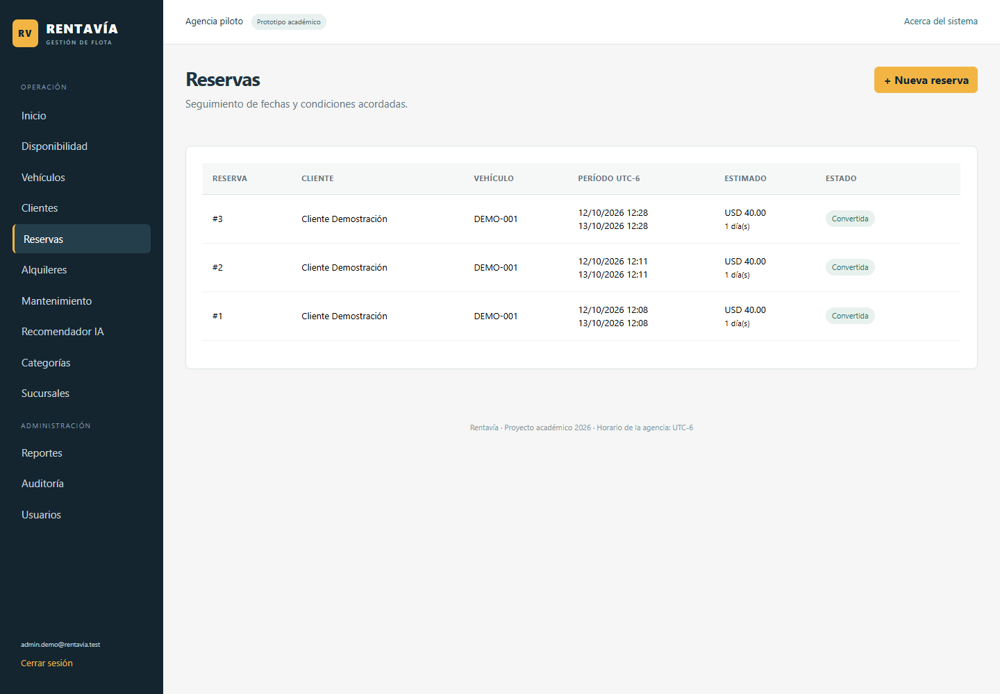
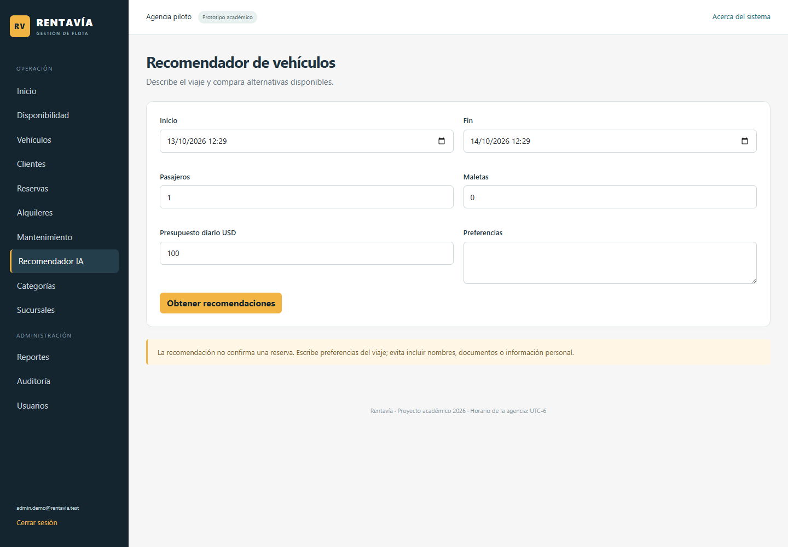
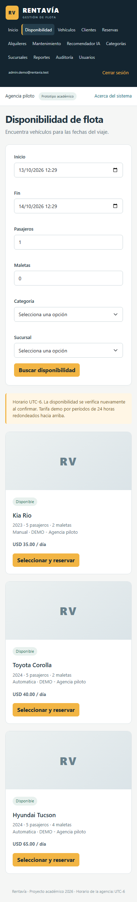

# Manual de usuario de Rentavía

Rentavía es el sistema interno de la agencia. Lo usan dos tipos de cuenta:

| Rol | Puede hacer |
| --- | --- |
| Empleado | Gestionar clientes y vehículos, consultar disponibilidad, reservar, entregar, recibir, registrar pagos, programar mantenimiento y usar el recomendador |
| Administrador | Todo lo anterior, más categorías, sucursales, eliminaciones, usuarios, reportes y auditoría |

Los clientes de la agencia no ingresan al sistema; el personal registra sus datos.

## Acceso

Abre la dirección que te indique el responsable (por ejemplo `http://localhost:8080`) e ingresa tu correo y contraseña. Después de cinco intentos fallidos la cuenta se bloquea durante diez minutos.

El menú lateral agrupa las opciones según la tarea:

| Grupo | Opciones |
| --- | --- |
| (inicio) | Inicio |
| Rentar | Buscar vehículo, Recomendador IA, Reservas, Alquileres |
| Flota y clientes | Vehículos, Mantenimiento, Clientes |
| Configuración | Categorías, Sucursales |
| Administración (solo administradores) | Reportes, Auditoría, Usuarios |

La barra superior indica siempre dónde estás (por ejemplo, Rentar › Reservas › Nueva reserva) e incluye el atajo **Nueva renta**, que abre Buscar vehículo. **Cerrar sesión** termina el acceso. Si intentas abrir una sección sin permiso, el sistema muestra un aviso.

### Ciclo de una renta

Toda renta sigue cuatro pasos, que se muestran como una guía en la parte superior de cada pantalla del proceso. Cada paso es un enlace a su pantalla:

1. **Buscar vehículo**: fechas, capacidad y filtros; o el Recomendador IA si el cliente no sabe qué elegir.
2. **Reservar**: elegir el cliente y confirmar el período.
3. **Entregar**: inspección de salida cuando el cliente recoge el vehículo.
4. **Devolver y cobrar**: inspección de llegada, cargos y pagos.

## Panel de inicio

Muestra lo que necesita atención: vehículos libres en este momento, reservas por entregar, alquileres en curso y devoluciones atrasadas (en rojo cuando hay alguna). Cada cifra abre el listado correspondiente. Debajo están la guía del ciclo de renta y dos listas de trabajo: **Próximas entregas**, con el botón Entregar, y **Próximas devoluciones**, con el botón Devolver. Las cifras se calculan con los datos de la base en ese momento.

## Catálogos

### Categorías y sucursales

Solo el administrador las crea y edita. Una sucursal inactiva deja de ofrecer sus vehículos en nuevas reservas. Una categoría o sucursal que ya tiene vehículos no se puede eliminar; en el caso de la sucursal, se desactiva desde Editar.

### Vehículos

En Vehículos, **Nuevo vehículo** abre el formulario con placa, marca, modelo, año, categoría, sucursal, pasajeros, maletas, kilometraje, transmisión, estado y tarifa diaria. También se puede subir una fotografía PNG o JPEG de hasta 2 MB.

- La placa sigue el formato Pxxx-xxx, con letras o números (por ejemplo, P123-456). Se guarda en mayúsculas y no puede repetirse.
- El kilometraje no puede bajar al editar.
- Para ofrecer un vehículo en reservas debe estar en estado Activo y tener tarifa mayor que cero.
- Cambiar la tarifa no altera las reservas ya creadas.

Si un vehículo tiene reservas o mantenimientos, al eliminarlo pasa a estado Retirado y conserva su historial.

### Clientes

Registra nombre, apellido, documento de identidad, teléfono y correo opcional. En **Tipo de documento** eliges DUI o Pasaporte: el sistema habilita solo la casilla del tipo elegido y desactiva la otra. El DUI se escribe con el formato 00000000-0; el pasaporte admite cualquier formato. No se permiten dos clientes con el mismo tipo y número de documento. Un cliente inactivo no puede reservar. Si el cliente tiene reservas, al eliminarlo queda desactivado.

Si dos personas editan el mismo registro a la vez, la segunda recibe un aviso para recargar la página antes de guardar.

## Disponibilidad y reservas

1. En Buscar vehículo (o con **Nueva renta**) indica inicio, fin, pasajeros y maletas. Categoría y sucursal son filtros opcionales.
2. Pulsa Buscar disponibilidad. La lista solo muestra vehículos sin reservas, alquileres ni mantenimientos en ese período, del más económico al más caro.
3. Elige un vehículo y pulsa Seleccionar y reservar.
4. Selecciona el cliente, revisa las fechas y confirma. Si el cliente aún no está registrado, usa **¿Cliente nuevo? Regístralo aquí**: al guardarlo vuelves a la reserva con el cliente ya elegido, sin perder el vehículo ni las fechas.

Al guardar, el sistema vuelve a revisar la agenda. Si otro empleado reservó ese vehículo en el mismo período, la reserva se rechaza con un mensaje.

El cobro se calcula por períodos de 24 horas, redondeados hacia arriba, en dólares y con horario UTC-6. La reserva guarda la tarifa diaria vigente en ese momento.

En Reservas se ven el estado, las fechas y el total acordado. Las pestañas Por entregar, Entregadas, Canceladas y Todas filtran el listado; por defecto se muestran las reservas por entregar, la más próxima primero. Una reserva entregada enlaza con su alquiler. Editar permite cambiar cliente y fechas manteniendo el vehículo y la tarifa original. Para cambiar de vehículo hay que cancelar y crear otra reserva. Cancelar libera la agenda y conserva el registro.

## Entrega, devolución y pagos

### Entregar

Desde una reserva por entregar (en Reservas o en Próximas entregas del inicio), pulsa Entregar. El formulario muestra el cliente, el vehículo y el período acordado antes de la inspección. Se puede hacer desde cinco minutos antes del inicio y mientras la reserva siga vigente. Registra kilometraje, porcentaje de combustible y observaciones de la inspección. La entrega crea el alquiler y mantiene ocupada la misma agenda de la reserva.

### Alquileres y detalle

En Alquileres, las pestañas En curso, Atrasados, Cerrados y Todos filtran el listado. Cada alquiler en curso tiene el botón Devolver, y los que tienen saldo pendiente, el botón Cobrar.

El detalle muestra cliente, vehículo, período, tarifa, inspecciones, total, pagos y saldo. El botón Imprimir genera una versión para papel.

### Registrar pagos

Indica monto (se propone el saldo pendiente), método (Efectivo, Transferencia o Tarjeta) y una referencia opcional. El monto no puede superar el saldo pendiente. Es un registro interno de la agencia; el sistema no cobra a tarjetas ni se conecta con bancos.

### Devolver

Registra el kilometraje final (no menor al de entrega), combustible, observaciones y, si corresponde, un cargo adicional con su concepto. Al confirmar, el alquiler se cierra, se actualiza el kilometraje del vehículo y se libera la agenda. El total final es el estimado de la reserva más el cargo. Si queda saldo, sigue visible en el detalle y se puede pagar después.

Un alquiler cuya fecha de fin ya pasó aparece como Atrasado en el panel de inicio, su detalle muestra un aviso y el vehículo no se ofrece en nuevas operaciones hasta registrar la devolución.

## Mantenimiento

Elige el vehículo, el tipo (Preventivo o Correctivo), las fechas, una descripción y el costo. Si el vehículo ya tiene reservas en ese período, el sistema rechaza el mantenimiento; primero hay que reprogramar o cancelar esas reservas. **Finalizar** libera la agenda y el registro queda en el historial.

## Recomendador IA

El recomendador ayuda a elegir un vehículo según el viaje.

1. Abre Recomendador IA.
2. Indica fechas, pasajeros, maletas y presupuesto diario.
3. Describe en texto libre lo que necesita el cliente, por ejemplo: "viaje a la playa con equipaje de surf, prefiere automático". No escribas nombres, documentos ni datos personales.
4. Pulsa **Obtener recomendaciones**.

El sistema filtra primero los vehículos disponibles que cumplen capacidad y presupuesto (hasta veinte). OpenAI elige entre ellos hasta tres opciones y explica por qué cada una encaja con lo solicitado.

La pantalla indica el origen del resultado:

- **OpenAI**: la recomendación la generó el modelo de IA.
- **Reglas (sin IA)**: el servicio no estaba disponible y el sistema muestra las opciones más económicas.

Captura por agregar: `docs/evidencias/ui/08-recomendacion-openai.png`, con un resultado de origen OpenAI.

La recomendación no crea reservas. El botón **Elegir vehículo** de cada sugerencia abre el formulario normal de reserva, que vuelve a comprobar la disponibilidad al guardar.

## Reportes, auditoría y usuarios

Estas secciones son solo para administradores.

**Reportes** permite elegir un rango de hasta un año y muestra pagos registrados, reservas creadas, entregas, costo de mantenimiento y el uso de cada vehículo. El uso se mide en horas reales entre entrega y devolución; los alquileres abiertos cuentan hasta el momento de la consulta.

**Auditoría** lista las últimas doscientas operaciones con fecha, usuario, acción y registro afectado.

**Usuarios** permite crear cuentas de Administrador o Empleado y bloquearlas o desbloquearlas. Nadie puede bloquear su propia cuenta. Al bloquear una cuenta, su sesión abierta se cierra en aproximadamente un minuto.

## Uso en el teléfono

La interfaz se adapta a pantallas pequeñas: el menú pasa a la parte superior y los formularios y tarjetas se acomodan en una sola columna.

## Mensajes frecuentes

| Mensaje | Qué hacer |
| --- | --- |
| El vehículo ya tiene una reserva, alquiler o mantenimiento en ese período | Elige otro vehículo u otras fechas |
| Otro usuario modificó este registro | Recarga la página y vuelve a aplicar el cambio |
| No se pudo guardar. Revisa duplicados | Revisa placa o documento repetidos |
| La categoría o sucursal está referenciada | Desactívala en lugar de eliminarla |
| No tienes permiso | Pide la operación a un administrador |
| Error con un código de referencia | Inténtalo de nuevo y comunica el código al responsable si persiste |
