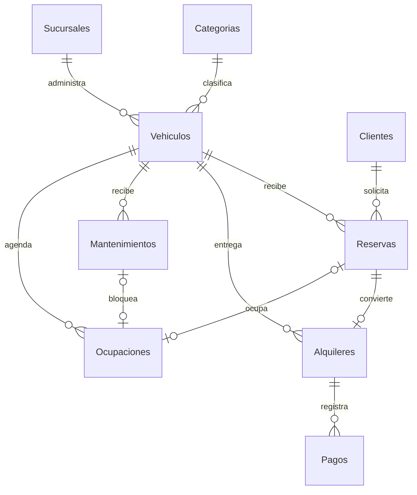
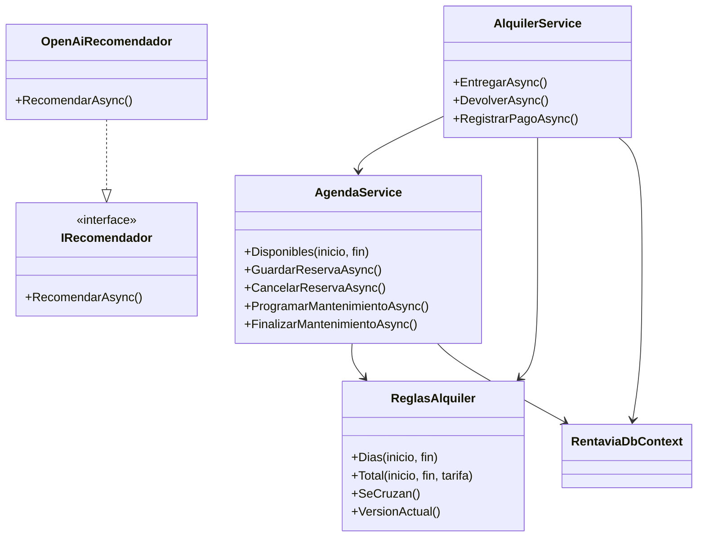
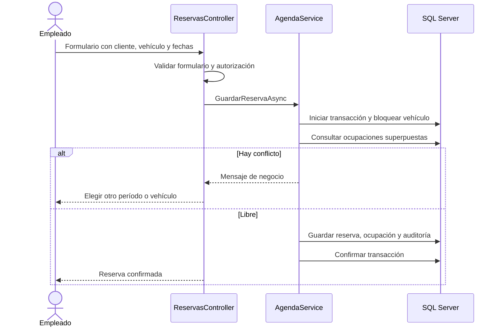

# Modelo de datos de Rentavía

Esquema resultante de las migraciones `BaseInicialSqlServer`, `OperacionDeRentas`, `ReferenciaAuditoria` y `DocumentoClienteSinLicencia`. La fuente del esquema es el modelo de EF Core; el SQL equivalente está en [Esquema-completo.sql](../../database/scripts/Esquema-completo.sql).

El origen de cada Ocupación es exclusivamente una Reserva o un Mantenimiento. La relación opcional refleja el esquema; el servicio crea una ocupación para cada nueva reserva/mantenimiento y la conserva cuando pasa a alquiler.

## Diccionario resumido

Todos los Id son `int IDENTITY` y PK. Las FK son int con borrado restringido. Los horarios son datetimeoffset UTC y los importes decimal(12,2).

| Tabla | Campos implementados | Reglas principales |
| --- | --- | --- |
| Categorias | Id; Nombre nvarchar(50); Descripcion nvarchar(max), opcional y sin límite | Nombre único |
| Sucursales | Id; Nombre(100); Direccion(200); Telefono(20), opcional; Activa bit | Inactiva excluye vehículos de nuevas reservas |
| Clientes | Id; Nombre/Apellido(50); TipoDocumento(20): DUI o PASAPORTE; NumeroDocumento(30); Telefono(20); Correo(100), opcional; FechaRegistroUtc; Activo; Version rowversion | Tipo+documento únicos; DUI con formato 00000000-0; cliente activo al reservar/entregar |
| Vehiculos | Id; CategoriaId; SucursalId; Placa(15); Marca/Modelo(50); Anio; capacidades; Kilometraje; Transmision/Estado(20); TarifaDiaria; FotoRuta(200), opcional; Version | Placa única; capacidad pasajeros positiva; km/maletas/tarifa no negativos; tarifa positiva exigida para reservar |
| Reservas | Id; ClienteId; VehiculoId; InicioUtc; FinUtc; CreadaUtc; TarifaDiaria; Dias; TotalEstimado; Estado(20); Version | Fecha final posterior; días/importes positivos; estados Confirmada, Cancelada, Convertida |
| Ocupaciones | Id; VehiculoId; ReservaId, opcional; MantenimientoId, opcional; InicioUtc; FinUtc; Activa | Un solo origen; fecha final posterior; índice por vehículo/activo/rango; origen único |
| Alquileres | Id; ReservaId; VehiculoId; EntregaUtc; DevolucionUtc, opcional; km inicial/final; combustible inicial/final; observaciones entrega/devolución(500); CargoAdicional; ConceptoCargo(150); MontoTotal; Estado(20); Version | Reserva única; un Abierto por vehículo; combustible 0-100; km final no menor; cargo no negativo |
| Pagos | Id; AlquilerId; FechaUtc; Monto; Metodo(30); Referencia(100), opcional | Monto positivo; servicio impide superar saldo; métodos Efectivo, Transferencia, Tarjeta |
| Mantenimientos | Id; VehiculoId; InicioUtc; FinUtc; Tipo(30); Descripcion(500); Costo; Finalizado | Costo no negativo; intervalo válido; servicio rechaza cruces |
| Auditorias | Id; FechaUtc; UsuarioId(450); Accion/Entidad(50); RegistroId; RegistroClave(450), opcional | Evento en la misma transacción; no almacena documentos ni claves |
| Recomendaciones | Id; FechaUtc; UsuarioId(450); EntradaJson; CandidatosJson; ResultadoJson; Origen(30); Modelo(100); VersionPrompt(30) | Guarda trazabilidad, diferenciando OpenAI y respaldo |

Las inspecciones de entrega y devolución se guardan como columnas de Alquileres, y el cargo adicional es un importe con su concepto. Con eso se simplificaron las tablas Inspeccion y CargoAdicional que proponía la Fase I. Pagos registra cobros internos; no se conecta con bancos.

Identity conserva siete tablas propias más `__EFMigrationsHistory`: diecinueve tablas totales contando las once tablas de negocio. Las contraseñas se administran mediante Identity; no hay una columna artesanal para acceso. UsuarioId de auditoría/recomendación conserva el identificador del actor, sin FK para no bloquear historial por cambios administrativos.

## Clases y flujo

Este modelo reemplaza al diagrama entidad-relación de la Fase I, que se planteó para PostgreSQL.
